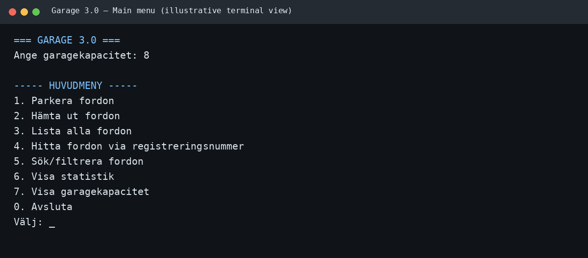
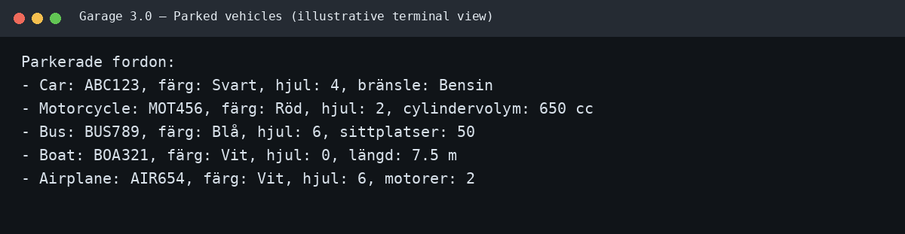
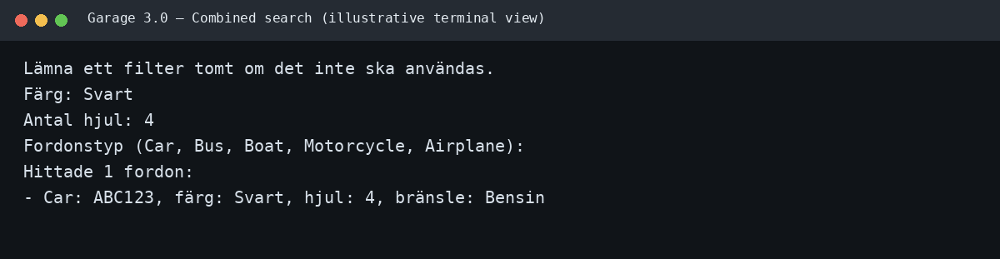
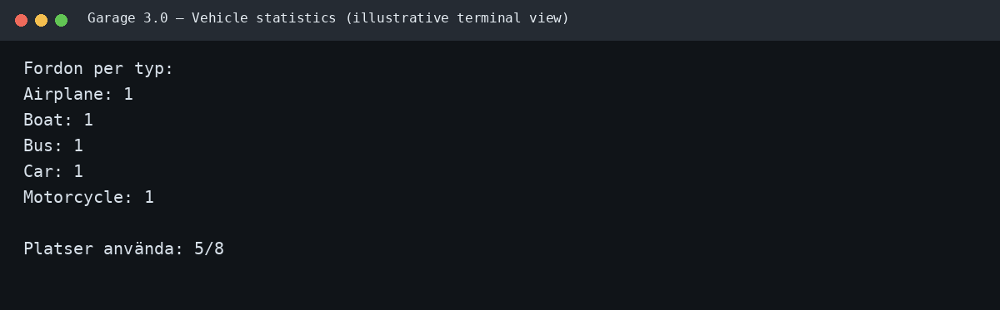

# 🚗 Garage 3.0

[](https://dotnet.microsoft.com/)
[](https://learn.microsoft.com/dotnet/csharp/)
[](https://xunit.net/)

A console-based vehicle garage manager built with modern .NET 8 and C#.

Garage 3.0 demonstrates object-oriented programming, generic collections, interfaces, LINQ, input validation, and automated unit testing in a small, easy-to-follow application.

> **Screenshot note:** The images below are illustrative terminal previews of the application's expected menus and output. They are not captured from a running .NET process.

## 🖥️ Screenshots

### Main menu


### List of parked vehicles


### Search using multiple properties


### Statistics by vehicle type


## 📋 Requirements

- .NET 8 SDK
- Visual Studio 2022, JetBrains Rider, or Visual Studio Code (optional)

## ▶️ Run the application

1. Download and extract the ZIP archive.
2. Open `Garage3.sln` in Visual Studio.
3. Make sure the `Garage3` project is selected as the startup project.
4. Restore NuGet packages if prompted.
5. Press **F5** to run.

You can also start the application from a terminal in the solution directory:

```bash
dotnet run --project Garage3/Garage3.csproj
```

The application asks for the garage capacity and then adds up to five sample vehicles, limited by the capacity entered.

## 🧪 Run the unit tests

The tests are in a separate xUnit project and follow Arrange–Act–Assert.

```bash
dotnet test Garage3.sln
```

## ✨ Features

- Create a garage with a capacity chosen by the user.
- Park cars, motorcycles, buses, boats, and airplanes.
- Retrieve a vehicle using its registration number.
- List all vehicles currently parked.
- Find a vehicle by registration number.
- Search by color, number of wheels, and vehicle type.
- Combine search filters; all entered filters must match.
- Show a count of each vehicle type.
- Reject duplicate registration numbers without regard to letter case.
- Handle invalid menu input without terminating the application.
- Pre-populate the garage with sample vehicles.

## 🗂️ Project structure

```text
Garage3
├── Interfaces
│   ├── IGarage.cs
│   ├── IHandler.cs
│   ├── IUI.cs
│   └── IVehicle.cs
├── Models
│   ├── Airplane.cs
│   ├── Boat.cs
│   ├── Bus.cs
│   ├── Car.cs
│   ├── Garage.cs
│   ├── Motorcycle.cs
│   └── Vehicle.cs
├── Handlers
│   └── GarageHandler.cs
├── UI
│   └── ConsoleUI.cs
└── Program.cs

Garage3.Tests
└── GarageTests.cs
```

## 🧩 Architecture and important concepts

| Component | Responsibility |
|---|---|
| `Vehicle` | Abstract base class with shared vehicle properties |
| `Car`, `Motorcycle`, `Bus`, `Boat`, `Airplane` | Specialized vehicle classes with their own properties |
| `Garage<T>` | Generic, fixed-capacity collection of vehicles |
| `GarageHandler` | Application logic between the UI and garage |
| `ConsoleUI` | Menus, user input, and output |
| `Program` | Application entry point |
| Interfaces | Define contracts and reduce direct dependencies |

### Generics and iteration

`Garage<T>` uses the constraint `where T : Vehicle`. This means the garage can only store `Vehicle` objects or classes that inherit from `Vehicle`.

The garage implements `IEnumerable<T>`, which allows it to be iterated with `foreach`.

### Registration number rules

Registration numbers are trimmed and normalized to uppercase when a vehicle is created. Searches and duplicate checks are also case-insensitive. For example, `ABC123`, `Abc123`, and `abc123` refer to the same registration number.

### Search behavior

Color, wheel count, and vehicle type are optional filters. If multiple filters are entered, they are combined using AND logic. For example, a search for black vehicles with four wheels returns only vehicles matching both conditions.

## ✅ Unit tests

The separate `Garage3.Tests` project uses **xUnit** and follows Arrange–Act–Assert.
The tests focus on the public API of `Garage<T>`, as requested in the assignment.

Coverage includes:

- Constructor rejects zero and negative capacity.
- Constructor populates a garage when the initial vehicles fit.
- Constructor rejects too many initial vehicles and duplicate registration numbers.
- `Add` succeeds when there is room.
- `Add` rejects a full garage, duplicate registration numbers (case-insensitive), and null vehicles.
- `Find` works regardless of letter case and returns `null` for missing or blank registration numbers.
- `Remove` succeeds for an existing vehicle and returns `false` when no matching vehicle exists.
- `Search` returns matching vehicles, returns an empty result when nothing matches, and rejects a null predicate.
- `foreach` iterates over every stored vehicle and performs zero iterations for an empty garage.

Run the tests from the solution directory:

```bash
dotnet test Garage3.sln
```

In Visual Studio, open **Test Explorer** and choose **Run All Tests**. The first run may restore the xUnit NuGet packages. A successful test run is reported by the test runner; no test result is assumed until you run it locally.

## 💡 Notes and possible extensions

This version models capacity as a number of vehicle slots, with each vehicle occupying one slot. Optional extensions from the assignment could include multiple garages, parking spaces with different sizes, persistence to JSON files, and vehicle-specific search fields.

The source files contain comments explaining the role of each class and important methods. Review the code and run the tests before submitting the assignment.
